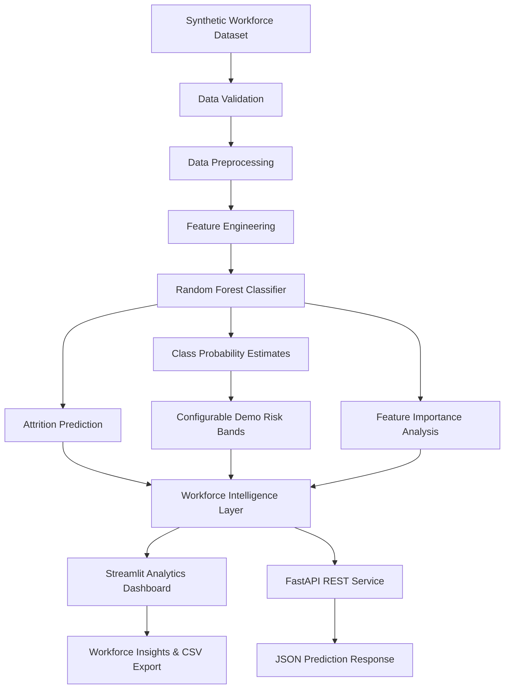

# Employee Attrition Prediction and Workforce Intelligence System

An AI-powered HR analytics prototype designed to analyse workforce data, identify patterns associated with employee attrition, and demonstrate how predictive analytics can support aggregate workforce planning. The system combines data preprocessing, Random Forest classification, probability-based attrition risk estimation, workforce analytics, and model interpretability through an interactive Streamlit dashboard and FastAPI REST service.

> **Responsible-Use Notice:** This project uses fully synthetic employee data and is intended exclusively for educational, research, and portfolio demonstration purposes. It is not a validated HR assessment tool. Predictions must not be used to make hiring, termination, promotion, compensation, performance-management, or other employment decisions about real individuals. Model outputs can reflect bias and must never replace employee conversations, fair HR practices, or human judgement.

## Key Features

- **Synthetic Workforce Data Generation:** Creates reproducible employee records for machine-learning experimentation.
- **Data Validation and Preprocessing:** Handles missing values, categorical variables, numerical features, and data consistency.
- **Machine Learning Classification:** Implements a Random Forest classifier to predict synthetic employee attrition labels.
- **Employee-Level Demonstration Scoring:** Generates model-based attrition predictions and class probability estimates for synthetic records.
- **Risk Categorisation:** Groups model outputs into configurable Low, Medium, and High demonstration risk bands.
- **Workforce Analytics:** Examines workforce patterns across departments, job roles, tenure, overtime, and other employment attributes.
- **Model Explainability:** Visualises global feature importance to understand which variables influence model predictions.
- **Interactive Dashboard:** Provides workforce KPIs, analytical charts, filters, and CSV export through Streamlit.
- **REST API Integration:** Exposes health-check and attrition-scoring functionality through FastAPI.
- **Testing and Documentation:** Includes unit tests and methodology documentation for reproducibility.

## System Architecture



## Core Analytical Modules

### 1. Workforce Data Generation and Preprocessing

Creates and prepares structured employee records for predictive modelling.

- Synthetic employee record generation
- Data validation and consistency checks
- Missing-value handling
- Categorical feature encoding
- Numerical feature preparation
- Reproducible dataset creation

### 2. Employee Attrition Prediction

Uses supervised machine learning to classify whether an employee record belongs to the synthetic attrition or non-attrition category.

**Baseline algorithm:** Random Forest Classifier

The classification pipeline analyses workforce attributes and produces:

- Predicted attrition class
- Class probability estimates
- Model evaluation metrics
- Global feature importance rankings

The model learns patterns from artificially generated labels. Its predictions do not establish whether an actual employee will leave an organisation.

### 3. Probability-Based Attrition Risk Categorisation

Uses model probability outputs to assign illustrative attrition risk bands.

| Risk Band | Interpretation |
|---|---|
| Low | Lower model-estimated attrition probability |
| Medium | Intermediate model-estimated attrition probability |
| High | Higher model-estimated attrition probability |

Risk categories are generated using configurable demonstration thresholds. They are not validated employee risk classifications or reliable estimates of an individual's future behaviour.

### 4. Workforce Intelligence and Exploratory Analytics

Explores workforce characteristics and patterns across different organisational dimensions.

**Workforce dimensions:**
- Department and job role
- Years at company and years in current role
- Monthly income and compensation-related variables
- Job satisfaction and work-life balance
- Overtime and business travel
- Training history and distance from home

**Analytical capabilities:**
- Workforce distribution by department
- Attrition-label distribution across job roles
- Tenure and experience analysis
- Overtime and attrition-pattern comparisons
- Job satisfaction and work-life balance analysis
- Workforce KPI visualisation

These analyses describe patterns in the synthetic dataset and should not be interpreted as causal explanations of employee behaviour.

### 5. Model Explainability

Provides model-level insights into the variables used by the Random Forest classifier.

- Feature importance rankings
- Comparison of influential workforce variables
- Feature importance visualisations
- Transparent presentation of model outputs

**Technical limitation:** Global feature importance describes patterns learned by the model. It does not establish causation or explain an individual employee's personal reasons for leaving.

### 6. Interactive HR Analytics Dashboard

The Streamlit dashboard brings workforce analysis and model outputs together in an interactive interface.

- Workforce overview and KPI summaries
- Department-wise employee distribution
- Attrition-label analysis
- Job role and tenure visualisations
- Overtime and satisfaction analysis
- Demonstration attrition scoring
- Model feature importance charts
- Interactive filters and CSV export

## Technology Stack

| Category | Technologies |
|---|---|
| Programming Language | Python |
| Data Processing | Pandas, NumPy |
| Machine Learning | Scikit-learn |
| Classification Algorithm | Random Forest |
| Data Visualisation | Matplotlib, Plotly |
| Dashboard | Streamlit |
| Backend API | FastAPI, Uvicorn |
| Data Format | CSV, JSON |
| Model Persistence | Joblib |
| Testing | Pytest |
| Development Environment | Jupyter Notebook, VS Code |
| Version Control | Git, GitHub |

## Quick Start

### Prerequisites

- Python 3.10 or later
- pip package manager
- Git (optional)

### 1. Clone the Repository

```bash id="m8s3qv"
git clone <repository-url>
cd <repository-folder>
```

### 2. Create a Virtual Environment

```bash id="q2h7nb"
python -m venv venv
```

**Windows:**
```bash id="a9k3fx"
venv\Scripts\activate
```

**macOS / Linux:**
```bash id="t5w8cp"
source venv/bin/activate
```

### 3. Install Dependencies

```bash id="b6n4vz"
pip install -r requirements.txt
```

### 4. Generate the Synthetic Workforce Dataset

```bash id="c7p2mw"
python scripts/generate_data.py
```

### 5. Train the Attrition Prediction Model

```bash id="d4x9rk"
python scripts/train_model.py
```

### 6. Launch the Streamlit Dashboard

```bash id="f3j6ys"
streamlit run app/streamlit_app.py
```

Open the local URL displayed in the terminal to access the interactive workforce analytics dashboard.

> **Note:** The commands above assume the example script and application paths exist in the repository. Adjust them to match the actual implementation.

## FastAPI Integration

The project includes a lightweight REST API for accessing the attrition classification functionality.

### Start the API Server

```bash id="h5k2pd"
uvicorn api.main:app --reload
```

### Access Interactive API Documentation

Open Swagger UI:

```text id="v8m4qn"
http://127.0.0.1:8000/docs
```

### API Endpoints

| Endpoint | Method | Purpose |
|---|---|---|
| `/health` | GET | Checks API availability |
| `/predict-attrition` | POST | Returns a synthetic attrition prediction |

### Example Input Parameters

- Employee age and monthly income
- Department and job role
- Years at company and current role
- Job satisfaction and work-life balance
- Overtime and business travel
- Distance from home and training history

The actual JSON request and response schemas should follow the implemented FastAPI endpoint.

## Model Evaluation

The Random Forest classifier can be evaluated using standard classification metrics.

| Metric | Purpose |
|---|---|
| Accuracy | Measures overall classification correctness |
| Precision | Measures the proportion of positive predictions that are correct |
| Recall | Measures the proportion of actual positive cases identified |
| F1-Score | Balances precision and recall |
| Confusion Matrix | Evaluates correct and incorrect predictions across classes |

Evaluation should use an appropriate held-out dataset and avoid data leakage between training and testing.

**Important:** Metrics obtained from synthetic employee records measure performance against artificially generated labels. They do not demonstrate real-world HR predictive accuracy or fairness.

## Project Structure

```text
Employee_Attrition_Intelligence/
│
├── api/
│   └── main.py                  # FastAPI application
│
├── app/
│   └── streamlit_app.py         # Interactive dashboard
│
├── data/
│   └── synthetic_employees.csv  # Synthetic workforce dataset
│
├── docs/
│   ├── methodology.md           # Project methodology
│   └── responsible_use.md       # Responsible-use documentation
│
├── notebooks/
│   └── exploratory_analysis.ipynb
│
├── scripts/
│   ├── generate_data.py         # Synthetic data generation
│   └── train_model.py           # Model training pipeline
│
├── workforce_analytics/
│   ├── preprocessing.py         # Data preparation
│   ├── model.py                 # Random Forest classifier
│   ├── evaluation.py            # Model evaluation
│   └── analytics.py             # Workforce analytics
│
├── tests/                       # Unit tests
│
├── requirements.txt
└── README.md
```

*This is a suggested repository layout. Retain the actual filenames and modules implemented in your project.*

## Model Notes and Limitations

- The target variable `attrition` is synthetically generated using a simulated formula.
- The classifier is trained on artificial records rather than verified employee departure histories.
- Risk bands use illustrative thresholds and should not be interpreted as validated individual assessments.
- Model probability estimates are not necessarily calibrated.
- Feature importance represents global model behaviour, not causal relationships.
- Synthetic-data performance cannot establish generalisation to real organisational workforces.
- Workforce patterns may reflect assumptions built into the synthetic data generator rather than genuine organisational behaviour.

## Responsible AI and Workforce Data Privacy

Employee-related analytics requires careful consideration of privacy, fairness, transparency, and organisational impact.

- Use synthetic or properly authorised, privacy-protected workforce data.
- Do not use predictions for hiring, termination, promotion, compensation, or disciplinary decisions.
- Avoid individual employee surveillance or profiling.
- Minimise personal information and avoid unnecessary sensitive attributes.
- Assess potential proxy variables and disparate impact before any research involving real workforce data.
- Interpret findings as aggregate analytical observations rather than individual employee judgements.
- Involve employees and qualified HR professionals in interpreting organisational workforce patterns.
- Ensure appropriate legal, privacy, security, and organisational review before considering real-world applications.

## Future Enhancements

- Advanced classification models such as XGBoost and LightGBM
- SHAP-based global and local model explainability
- Model probability calibration
- Fairness and subgroup performance evaluation
- Workforce trend forecasting
- Employee engagement and retention analytics
- Interactive organisational KPI monitoring
- Secure role-based access control and audit logging
- Database integration and automated data pipelines
- Docker-based deployment and cloud hosting

## Author

**Mohamed Riyaz S.**  
Integrated M.Tech – Computer Science and Engineering (Business Analytics)  
Vellore Institute of Technology (VIT), Chennai
